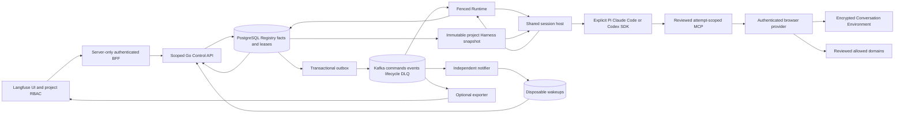

# Architecture

The only product path is Langfuse UI/BFF -> authenticated Go Control API ->
project Registry snapshots -> fenced Runtime/Browser Workers. PostgreSQL
preserves facts; Kafka preserves delivery; Redis preserves live experience.
The optional exporter projects actual canonical traces into Langfuse without
being on the execution critical path.

## Managed Topology

Every request carries server-authenticated Go/LF project, actor and role scope.
The BFF selects Conversations dynamically; the trusted seed establishes a
project binding, not fixed product routing. Global mutable catalog/project
creation and agent/model-only submissions are absent.

## Admission And Execution

Message creation accepts content, explicit runtime and immutable Harness
version, plus idempotency key. One transaction resolves project capabilities,
pins the full snapshot and requires an owned ready Environment before queuing
new work. Existing managed hashes and replay-before-readiness behavior remain.
Each Conversation owns one encrypted browser Environment. Current Lease,
generation and fencing identity gate execution and evidence writes.
Uncertain expired execution is quarantined as lost/needs_review; no automatic
external-effect replay or identity reset follows.

The Go transport supervises one long-lived Node host per Runtime process and
routes normalized `pi-browser-harness.v1`/`pi.*` JSONL by Run and Attempt.
The host accepts shared `run`, `cancel`, `shutdown` commands, requires an
explicit supported SDK and validated snapshot, and has no disk-Skill,
startup-module or default-Pi execution fallback.

Official Pi, Claude Agent SDK query and Codex startThread/runStreamed adapters
share the session contract. Reviewed capabilities are SDK-free; changing
Runtime does not require another Harness. Selected MCP transports and private
Attempt resources are released only after SDK/browser cleanup is joined.
The concurrency slot stays held through `harness.released`.
Missing shutdown acknowledgement retains files and fails cleanup.
A host failure may affect sibling sessions; independently detached descendants
have no separate join acknowledgement. First evidence-write failure cancels
the affected session instead of continuing unrecorded side effects.

Codex defaults to native Responses; explicit `flat-functions` adapts namespace
declarations at the provider boundary without replacing actual SDK/MCP results
or usage. No additional deployed service is introduced.
The selected Harness supplies its required settled verdict; durable cancel
overrides it. Assistant prose or missing verdict cannot create success.

## Browser And Evidence

Browser session open/replay requires internal auth, complete strict body
project/Environment/generation/fencing identity and a held browser handle.
Provider affinity preserves identity placement. Profile state and fencing
high-water marks are encrypted; reset/delete require acknowledged managed
lifecycle transitions. Independent local profile directories are not
horizontal shared identity storage.

Browser-case-authoring and deterministic case building retain actual tool
results, fresh-context dry runs and screenshot evidence. The interoperability
contract stays at `fixtures/contract/case_contract.json`. It is not another
control plane. Model-supplied grounding metadata is structurally validated,
not independent proof of prior-observation provenance.
Controlled takeover is one-time, scoped and audited; worker tokens/handles
never become public capabilities. Authenticated root `/artifacts` access is
retained for Management and the BFF.

SSE always replays ordered persisted event sequences; Redis only wakes readers.
Canonical completion is `run.completed`; aliases are retired, historical rows
and applied additive migrations retained. Pi can report captured inputs/call
intervals; Claude query totals belong to the Run root, not individual model
generations; Codex reports turn usage and host timing. Unknown inputs, timing
or billed cost are not fabricated.

## Rerun And Deployment

Explicit failed-Run rerun preserves source message, immediate parent and
immutable snapshot while assigning fresh Run/evidence identities and current
ready Environment generation. Publish/revoke cannot mutate earlier Runs.
Historical nonexecutable snapshots remain readable, not silently substituted.
Kafka/DLQ redelivery retries durable delivery, not a new user Run.

The native launcher always bootstraps Management before fixture/Worker/API/
Runtime and optional Exporter, and uses existing private Langfuse. Four Kafka
topics require at least eight partitions; native default concurrency is four.
Existing undersized topics require reviewed operator upgrade; metadata/offsets
are never reset by startup. Dockerfiles are component builds, not orchestration.
See [setup](management-runtime-setup.md) and [operations](operations.md).

Current managed acceptance covers SDK/browser, immutable Registry/rerun,
identity/control/reset/delete, scoped PG/SSE and optional real export.
Finite fault/load and owned isolated infrastructure acceptance remain separate.
Retirement does not establish identical legacy coverage; detailed limits are
in setup and the parent-owned cleanup report. Dated historical reports retain
their original results, not current deployed source/build parity claims.
