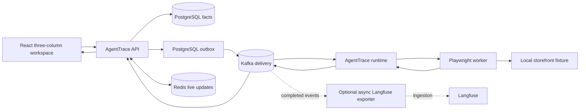

# Architecture

AgentTrace Eval Hub v3 is one durable browser-evaluation workflow. The React
workspace presents projects, conversations, and run traces in three columns.
The API stores requests in PostgreSQL and appends outbox rows atomically. Kafka
delivers commands to the runtime, which uses the scripted model fixture by
default and calls the Playwright worker. The worker evaluates the local fixture
site and returns evidence that becomes durable run events and trace details.

PostgreSQL preserves facts; Kafka preserves delivery; Redis preserves live experience.

## Canonical browser scenario

`integration/v3/canonical_scenario.py` creates a project and conversation,
sends the deterministic browser-evaluation request, follows the run SSE stream
until it succeeds, and verifies PostgreSQL facts and browser evidence. The
scripted model drives the local storefront fixture: filter `alpha`, open the
detail page, add two items, and verify the cart summary. It runs entirely
against Compose services and does not need an external model key.

The retained browser-case interoperability contract remains
`fixtures/contract/case_contract.json`. It is consumed by the worker contract
tests; it is not a second control-plane architecture.

## Runtime topology

PostgreSQL owns projects, conversations, messages, runs, events, traces,
operations, idempotency, and pending outbox rows. Kafka topics carry immutable
command and event envelopes and have a dedicated DLQ. Redis is not a source of
truth: when unavailable, the API's SSE stream uses `postgres_poll`. Langfuse
is an optional profile and asynchronously observes completed work; it is not
on the request or runtime critical path.
