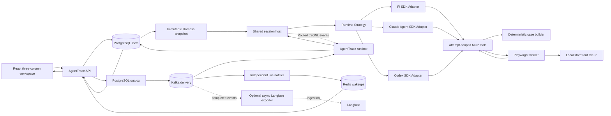

# Architecture

AgentTrace Eval Hub v3 is one durable browser-evaluation workflow. The React
workspace presents projects, conversations, and run traces in three columns.
The API stores requests in PostgreSQL and appends outbox rows atomically. Kafka
delivers commands to the runtime, which owns one long-lived **session host**
subprocess. Each execution attempt selects an independent Pi, Claude Code or
Codex SDK session. PostgreSQL manages Harness records containing system prompt,
skills and MCP servers, copied into immutable Run snapshots. The default
browser Harness exposes attempt-scoped MCP tools backed by
deterministic TypeScript logic and the Playwright worker. The worker evaluates the local fixture site and
returns evidence that becomes durable run events and trace details. The Go
runtime consumes the harness's newline-delimited event stream and writes Trace
records and terminal Run status to PostgreSQL.

PostgreSQL preserves facts; Kafka preserves delivery; Redis preserves live experience.

## Canonical browser scenario

`integration/local/acceptance.py` creates an isolated project and executes the
real `glm-5.3-flash` model against native services. It checks a minimal browser
case and its fresh-context dry run, a failed assertion and active cancellation.
It verifies PostgreSQL evidence, Kafka delivery, Redis notifications, ordered
SSE replay and real Langfuse traces. `integration/v3` retains deterministic
container scenarios as an additional execution path.

The retained browser-case interoperability contract remains
`fixtures/contract/case_contract.json`. It is consumed by the worker contract
tests; it is not a second control-plane architecture.

## Runtime topology

PostgreSQL owns projects, conversations, messages, runs, events, traces,
operations, idempotency, and pending outbox rows. Kafka topics carry immutable
command and event envelopes and have a dedicated DLQ. Redis is not a source of
truth: when unavailable, the API's SSE stream uses `postgres_poll`. Langfuse
is jointly started in native acceptance and asynchronously observes completed work; it is not
on the request or runtime critical path.

## Replaceable execution boundaries

The Go transport owns process supervision and routes normalized events by
`run_id + attempt_id`. The Node host owns session lifetimes through an
`ExecutionSessionFactory`; it does not import the Pi SDK. The Pi adapter owns
the SDK's model loop and translates an SDK-free Harness snapshot into
resources and MCP registrations. Claude Code and Codex have independent lazy
SDK adapters behind the same session contract. The browser Harness owns browser-specific
authoring, evidence and completion policy. Langfuse consumes persisted traces
through its separate exporter and does not select tools or own sessions.

`GET /api/v1/runtimes` exposes public model identities and local readiness.
Harness CRUD uses `/api/v1/harnesses`; message submission selects `runtime_id`
and `harness_id`. The API selects the public model from server configuration.
PostgreSQL atomically stores the entire snapshot in the Run and queued command.
Harness updates increment revisions; deletion does not invalidate existing
Runs. Restart does not overwrite edited or deleted catalog seeds.

Each Attempt materializes private temporary skills and MCP environment
references. Pi registers selected stdio servers directly. Claude Code and Codex
use an Attempt-owned loopback MCP adapter retaining the stdio connection,
forwarding actual tool results and keeping cleanup tools hidden from models.
Its listener and children close after SDK work and browser release are joined.
Pi awaits the public transport `onClose` acknowledgement, including transports
replaced during reconnects. Claude and Codex supervise their direct SDK child
and await process close before releasing MCP. A missing shutdown acknowledgement
raises `SessionCleanupError` and retains Attempt files instead of reporting a
successful release. SDK process groups receive termination signals; arbitrary
detached descendants are not independently joined.

Codex defaults to the native Responses protocol. Providers that ignore selected
MCP namespace declarations can explicitly use
`AGENTTRACE_CODEX_TOOL_FORMAT=flat-functions`. An Attempt-owned loopback adapter
translates declarations and function-call names at the provider boundary. The
official SDK and native CLI still execute actual MCP tools; arguments, tool
results, model text and usage are preserved. The listener closes after SDK exit
and before MCP release. This compatibility option adds no deployed service.

`AGENTTRACE_HARNESS_MODULE` retains trusted startup-module compatibility for
legacy requests without an execution snapshot. Another host
implementation can use the same JSONL protocol through the configured command
and entrypoint. The `pi.*` event names and `pi-browser-harness.v1` identifier are
retained wire compatibility names.

Production starts the host with `--server`, sends `run`, `cancel`, and
`shutdown` commands, and waits for `harness.ready`. Every attempt has its own
strict event decoder and sequence. `harness.settled` includes the selected
Harness's required `succeeded` or `failed` verdict. Durable cancellation
overrides the policy. Generic request fields are Run/Attempt identity, goal and
public model reference; browser fields and evidence are separate extensions.

The runtime holds the concurrency slot until `harness.released`, emitted after
awaited session shutdown and MCP cleanup. A normal cancellation targets one
session. A process crash, invalid stream or cancellation that exceeds its
termination grace fails all active sessions in that host and reaps its process
group. A later submission starts a new host; the transport does not replay
external operations automatically.

First evidence-write failure stops the affected session and awaits cleanup.
Generic persistence projects lifecycle, models and tools; a separate browser
projection handles operation and Case evidence. No unused Redis lease or cancel
hint remains. A shared `run.completed` event carries Run ID, status and optional
error to both durable readers and exporter. Model trace data preserves SDK
granularity: Pi supplies captured model inputs and call intervals; Claude
supplies assistant messages and cumulative query/model usage; Codex supplies
completed-turn text, usage and host-measured turn intervals. Missing per-call
inputs, timings and billed costs remain unknown.
Claude query/model totals have distinct identities per SDK result, provider
and model and attach to the Run root. Langfuse exports those totals as Trace
and root metadata, preserving the distinction from individual GENERATION
usage. Actual MCP tool content, structured results and error flags are retained
in canonical tool evidence across all three adapters.

## Failed-Run rerun lineage

A Run records its originating user message in `source_message_id`. A user rerun
is a new Run with the same `source_message_id` and an immediate parent recorded
in `retry_of_run_id`; it copies the failed Run's immutable specification,
receives a new Run ID, and starts at checkpoint zero. The source Run and all of
its durable evidence remain unchanged. The new execution persists its own
spans, usage, operation results, events, and artifacts with identities that do
not overlap the source.

This is a user-requested execution, not Kafka/DLQ delivery recovery. Kafka
redelivery and DLQ handling retry durable transport or consumer work without
creating a Run. A user rerun is eligible only when its direct source Run is
`failed`, uses an idempotency key scoped to that source, and may repeat the
original external effects.
