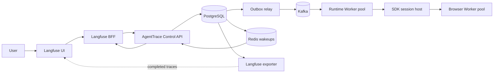
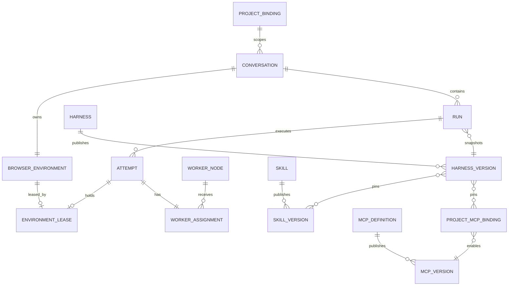

# Langfuse Agent Runtime Management 设计计划

状态：用户已授权实施；Phase 0–4 已实现并完成本地验收
日期：2026-10-28
范围：Langfuse 主产品、AgentTrace 执行控制面、Skill/MCP Registry、
动态 Conversation、Browser Environment、Worker 调度与故障恢复。

实现与测试记录：[验收报告](../../management-runtime-acceptance-2026-10-28.md)。
本地有限负载、故障注入和真实浏览器验收不代表生产容量或长期稳定性认证；
部署约束及未覆盖的第三方 2FA、跨节点浏览器存储等范围见验收报告。

## 1. 决策摘要

本设计把 Langfuse 保持为唯一用户入口，不建设第二套 Agent 管理产品。
AgentTrace Control API 作为 Langfuse 背后的内部执行领域服务，管理长任务、
可执行资源和浏览器环境。PostgreSQL 保存唯一事实，Kafka 负责可靠投递与
并行消费，Redis 负责实时通知和热状态。Runtime Worker 和 Browser Worker
可以独立横向扩容。

关键产品规则：

- 不设计多 Agent 协作、委派或 Agent 图。
- 一个 Run 选择一个 Runtime 和一个 Harness。
- 支持多个 Runtime、多个 Harness、多个 Conversation 和并发独立 Run。
- 一个 Conversation 默认且强制独占一个 Browser Environment。
- Browser Environment 是用户可管理的长期资源，Run 只通过 Lease 临时使用。
- Skill 是静态内容资产；MCP 是可执行工具服务，两者采用不同的注册和权限模型。
- 不建设通用 Linux/VM 沙盒，只建设受控浏览器执行环境。
- 已经开始产生外部副作用的 Attempt 不自动重放。

## 2. 目标与非目标

### 2.1 目标

1. 在 Langfuse 中动态创建、选择、查看、归档和删除 Conversation。
2. 每个 Conversation 自动拥有一个独占 Browser Environment。
3. 用户可以管理环境状态、持久化浏览器身份、重置环境并查看占用情况。
4. Project 用户可以上传、版本化和选择 Skill。
5. 系统管理员可以发布受控 MCP；Project 管理员可以启用并绑定参数和 Secret。
6. Harness 引用固定的 Skill/MCP 版本，Run 固化解析后的不可变快照。
7. Run 支持创建、取消、失败重跑、链接、删除保护和完整审计。
8. Worker 支持容量上报、Lease、心跳、fencing token、故障回收和横向扩容。
9. Redis、Kafka 或 Worker 局部故障不改变 PostgreSQL 中的 canonical facts。
10. 保留 Langfuse 原生 Trace、Usage、Dataset 和 Evaluation 能力。

### 2.2 非目标

- 多 Agent 协作、Agent delegation、Agent graph 或 child-agent orchestration。
- 任意 Shell、任意文件系统、用户自定义容器镜像或完整 VM 沙盒。
- 允许普通用户提交任意 MCP `command`、宿主机路径或任意环境变量。
- 自动重放已经执行过外部操作的 Attempt。
- 让 Redis 成为任务队列、Lease 权威或 Run 历史存储。
- 让 Langfuse Trace 反向修改 AgentTrace Run 状态。
- 第一阶段实现跨地域调度、跨云容灾或自动扩缩容控制器。

## 3. 为什么不是把所有逻辑写进 Langfuse

Langfuse 的主要领域是用户、Project 权限、LLM Trace、Prompt、Dataset、
Evaluation 和分析。Agent 执行平台还需要长任务状态机、幂等命令、取消、
失败重跑、可执行 Harness 快照、Browser Environment、Worker Lease、
fencing token 和外部副作用恢复策略。

评估过三个方案：

| 方案 | 优点 | 主要问题 | 结论 |
| --- | --- | --- | --- |
| 深度修改 Langfuse 后端 | 服务数量少 | 上游升级冲突；执行故障进入产品面；领域边界混杂 | 不采用 |
| Langfuse BFF 直连 AgentTrace DB/Kafka | 少一次内部网络调用 | 绕过领域校验；BFF 持有底层凭证；DB/Kafka 双写风险 | 不采用 |
| 独立 AgentTrace Control API | 事务、权限和状态机集中；独立扩容；Langfuse 可升级 | 多一个内部服务和网络跳 | 采用 |

Control API 不是第二个产品。它没有独立用户体系和管理 UI，只接受
Langfuse BFF、Worker 和内部运维身份的请求。若未来所有任务都变成同步、
无状态调用，并且不再需要 Environment、Lease 和可靠调度，应重新评估并
合并该服务。

## 4. 系统边界与所有权



| 资源 | 唯一权威 | 说明 |
| --- | --- | --- |
| User、Organization、Langfuse Project membership | Langfuse | AgentTrace 不复制用户体系 |
| Project 执行命名空间绑定 | AgentTrace | 一对一映射到 Langfuse Project |
| Conversation 执行线程 | AgentTrace | Langfuse 只提供产品入口 |
| Run、Attempt、取消、重跑、幂等 | AgentTrace | canonical execution facts |
| Skill、MCP、Harness | AgentTrace | 可执行配置与不可变版本 |
| Browser Environment、Lease、Worker | AgentTrace | 执行资源与调度 |
| Trace 产品展示、Usage 分析 | Langfuse | 由 Exporter 单向投影 |
| Kafka delivery、Redis wakeup | 基础设施 | 都不是业务事实源 |

### 4.1 标识映射

- `project_bindings.langfuse_project_id` 唯一映射到一个
  `agenttrace_project_id`。
- AgentTrace `conversation_id` 是执行线程的 canonical ID，Langfuse BFF
  将它作为显式参数传递，不再使用固定 `AGENTTRACE_CONVERSATION_ID`。
- Langfuse Session ID 使用确定性映射
  `agenttrace-session-{conversation_id}`，仅用于 Trace 分组。
- Langfuse Trace ID 保持
  `agenttrace-trace-{run_id}`。
- Langfuse Session/Trace 不作为 Conversation/Run 的反向写入入口。

## 5. 核心资源模型



### 5.1 Project binding

`project_bindings`：

- `langfuse_project_id`，唯一。
- `agenttrace_project_id`，唯一。
- `status`：`active | suspended | deleting`。
- `created_at`、`updated_at`。

Langfuse 是租户和权限权威。AgentTrace Project 只提供执行命名空间，不暴露
独立成员管理。

### 5.2 Conversation

Conversation 是用户可选择的任务线程，状态为：

```text
active -> archived
active/archived -> deleting -> deleted
```

创建 Conversation 时，在同一个 PostgreSQL 事务中创建：

1. Conversation。
2. 独占 Browser Environment 记录。
3. Environment provisioning Outbox。

Conversation 在 Environment 达到 `ready` 前可查看但不能提交浏览器 Run。
非浏览器 Harness 可以由策略决定是否允许提前执行；第一版统一等待
Environment ready，以保持产品状态简单。

删除规则：

- 有非终态 Run、未完成 Outbox/Inbox 或有效 Lease 时返回冲突。
- 用户可以先取消活跃 Run，再重新删除。
- 删除进入 `deleting`，异步清理 Browser Profile 和受管文件。
- 清理成功后保留最小 tombstone 和审计记录。
- Langfuse Trace 遵循 Langfuse 自己的 retention，不与执行数据做分布式删除事务。

### 5.3 Browser Environment

每个 Conversation 恰好拥有一个 Environment，数据库使用唯一约束保证
一对一关系。

建议字段：

- `id`、`project_id`、`conversation_id`。
- `state`：
  `provisioning | ready | leased | resetting | needs_review | deleting | broken`。
- `profile_generation`：每次 reset 递增。
- `profile_ref`：加密 Browser Profile/Storage State 的受管引用。
- `policy`：允许域名、下载/上传限制和可选代理策略。
- `last_used_at`、`created_by`、`created_at`、`updated_at`。

用户能力：

- 查看状态、最近使用时间和当前 Run。
- 启动一次受控用户接管，用于登录、2FA 或人工检查。
- 停止接管。
- 重置 Profile。
- 删除 Conversation 时删除 Environment。

第一版只实现浏览器环境，不提供 Shell、任意文件系统或通用进程执行。
用户接管通过可替换的 Browser Provider 接口实现；本地实现可以采用
受控 CDP screencast/input gateway，托管实现可以使用支持 Live View 的
远程浏览器服务。控制 URL 必须短时有效、一次性、Project scoped，且不暴露
Worker 内部地址。

### 5.4 Environment Lease

同一 Environment 同一时刻最多一个有效 Lease。

建议字段：

- `environment_id`，唯一。
- `attempt_id`，唯一。
- `runtime_worker_id`、`browser_worker_id`。
- `fencing_token`，按 Environment 单调递增。
- `acquired_at`、`renewed_at`、`expires_at`。
- `state`：`active | releasing | expired | released`。

Worker 的每次事件、证据写入、完成和释放请求都携带 `fencing_token`。
Control API 使用条件更新拒绝旧 token。TTL 负责最终回收，fencing token
负责阻止暂停或网络分区后的旧 Worker 恢复写入。

## 6. Skill、MCP 与 Harness Registry

### 6.1 为什么拆分

Skill 是提示词和文件组成的静态内容资产；MCP 是可以启动进程、访问网络、
文件和 Secret 的执行能力。使用同一上传和权限模型会把普通内容管理变成
远程代码执行入口。

因此：

- Skill：Project scoped，允许 Project 用户上传，Project 管理员发布。
- MCP Definition/Version：系统管理员发布受控制品。
- Project MCP Binding：Project 管理员启用版本并绑定参数和 Secret 引用。
- Harness：Project scoped，引用固定 Skill Version 和 MCP Binding。

### 6.2 Skill 数据模型

`skills`：

- `id`、`project_id`、`name`、`slug`、`status`。

`skill_versions`：

- `id`、`skill_id`、递增 `version`。
- `manifest`、`content_ref`、`content_digest`。
- `created_by`、`created_at`、`revoked_at`。
- 发布后不可修改。

上传流程：

1. 浏览器上传文件夹或压缩包；不接受用户电脑绝对路径。
2. 服务写入隔离 staging 区。
3. 拒绝绝对路径、`..`、符号链接、设备文件、超限大小和未知类型。
4. 识别根 `SKILL.md`、manifest 和附属文件。
5. 规范化换行和路径，计算 digest。
6. 返回预览和校验结果。
7. 管理员发布不可变版本。
8. Run materialization 只读取已发布内容。

路径字段表示 Skill 包内的相对目标路径，不表示服务端或用户主机源路径。

### 6.3 MCP 数据模型

`mcp_definitions`：

- `id`、`name`、`slug`、`owner_scope=system`、`status`。

`mcp_versions`：

- `id`、`mcp_definition_id`、递增 `version`。
- `transport`：第一版支持 `stdio`，预留 `streamable_http`。
- `executable_ref`：已审核的可执行制品或 Worker image capability key。
- `args_schema`、`config_schema`、`secret_schema`。
- `declared_tools`、`host_only_tools`。
- `filesystem_policy`、`network_policy`、`resource_policy`。
- `content_digest`、`created_by`、`created_at`、`revoked_at`。

`project_mcp_bindings`：

- `project_id`、`mcp_version_id`。
- 已校验的非敏感参数。
- Secret Manager 引用映射，不保存明文。
- `enabled`、`created_by`、`updated_at`。

禁止：

- 普通用户提交任意 `command`。
- 使用 `env:NAME` 读取 Worker 任意环境变量。
- MCP 获得未声明的宿主目录或网络访问。
- 将 Secret 明文复制进 Harness/Run snapshot、事件或日志。

第一版不建设完整容器沙盒。MCP 只能引用已经部署并审核的 Worker capability；
如果未来开放第三方 MCP，必须先引入独立进程隔离、UID、文件系统、网络和资源
配额，再修改该决策。

### 6.4 Harness 版本

`harnesses` 和 `harness_versions` 都是 Project scoped。

Harness Version 包含：

- `system_prompt`。
- 固定 `skill_version_ids`。
- 固定 `project_mcp_binding_ids`。
- Runtime 兼容约束。
- 创建人、发布时间和 digest。

创建 Run 时，Control API 解析并固化：

- Harness identity/version。
- Skill bytes、文件 digest 和来源版本。
- MCP version、已校验参数、Secret 引用标识。
- Runtime、公开模型 identity 和 Environment identity。

Run snapshot 不包含 Secret 明文。Runtime Worker 在 Lease 有效期间按引用获取
最小范围 Secret。Harness 更新、Skill/MCP 发布新版本或 Registry 删除都不改变
历史 Run。失败重跑继续使用源 Run snapshot。

## 7. 动态 Conversation 路由

当前首闭环通过环境变量固定一个 Conversation。目标设计改为每个请求显式携带：

```text
langfuseProjectId
agenttraceConversationId
runId（需要时）
```

Langfuse BFF 的每个 procedure：

1. 校验当前用户的 Langfuse Project membership 和操作权限。
2. 查询 server-side Project binding。
3. 调用 Control API 的 Project-scoped endpoint。
4. Control API 再校验 Conversation/Run/Environment 的实际 ownership。

浏览器永远不接触 bridge token、Worker endpoint、模型凭证或 Secret。

建议 API：

```text
GET    /api/v1/projects/{projectId}/conversations
POST   /api/v1/projects/{projectId}/conversations
GET    /api/v1/conversations/{conversationId}
PATCH  /api/v1/conversations/{conversationId}
DELETE /api/v1/conversations/{conversationId}

GET    /api/v1/conversations/{conversationId}/environment
POST   /api/v1/environments/{environmentId}/control-session
POST   /api/v1/environments/{environmentId}/reset
DELETE /api/v1/environments/{environmentId}

POST   /api/v1/conversations/{conversationId}/runs
GET    /api/v1/conversations/{conversationId}/runs
```

Langfuse UI 增加：

- Conversation 列表、创建、选择、归档和删除。
- 当前 Conversation 的 Environment 状态和管理入口。
- Runtime/Harness 选择和 Agent Run 列表。
- 管理员可见的 Skill、MCP、Harness Registry。
- 管理员可见的 Worker/Runtime readiness 和容量概览。

不建设 AgentTrace 独立前端。

## 8. 调度与数据一致性

### 8.1 PostgreSQL

PostgreSQL 是唯一事实源，保存：

- Conversation、Environment、Run、Attempt。
- Registry、Harness snapshot。
- Worker 注册、Assignment、Lease、fencing token。
- Inbox、Outbox、idempotency。
- Events、Trace、Evidence、Artifacts references。

所有状态转换使用短事务。严禁在外部模型或浏览器执行期间保持 Inbox/数据库
事务打开。

### 8.2 Kafka

Kafka 负责可靠投递、背压和 Consumer Group 并行，不保存 canonical Run 状态。

建议命令：

```text
run.requested
run.cancel_requested
environment.provision_requested
environment.reset_requested
environment.delete_requested
```

`environment_id` 作为执行命令 partition key，使同一 Environment 的命令有序，
不同 Environment 跨 Partition 并行。Project/Run/Attempt identity 放入 envelope，
不放 Secret。

消息至少一次投递，因此消费者必须使用 Inbox 和幂等状态机。Kafka redelivery
只恢复投递处理，不创建新的用户 Run。用户发起失败重跑时，Control API 先创建
带 `retry_of_run_id` 的新 Run，再为这个新 Run 发布普通 `run.requested`。

### 8.3 Redis

Redis 只用于：

- Run/Event SSE wakeup。
- Worker 心跳和容量 TTL 的快速视图。
- Assignment wakeup。
- Runtime readiness 热缓存。
- 短期速率限制。

Redis 不保存 Run 历史、不实现 Environment 锁、不替代 Kafka。Redis 不可用时：

- SSE 回退到有界 PostgreSQL polling。
- Worker liveness 使用持久 `last_seen_at` 的保守判断。
- 新调度可以降速或暂停，但不能产生重复 Lease。

### 8.4 一次 Run 的主流程

1. BFF 提交带 idempotency key 的创建请求。
2. Control API 校验 Project、Conversation、Environment、Runtime 和 Harness。
3. PostgreSQL 短事务创建 Message、Run、Snapshot 和 Outbox。
4. Outbox Relay 发布 `run.requested`。
5. Runtime Worker Consumer 接收命令并做短 Inbox claim。
6. Worker 原子申请自身容量、Browser Worker Assignment 和 Environment Lease。
7. 获得 fencing token 后创建 SDK Session 和 Browser Context。
8. 执行期间事件写入使用短事务，Redis 只发送 wakeup。
9. 完成时携带 fencing token 原子提交 Attempt、Run、assistant message、
   event 和 completion outbox。
10. 释放浏览器和 MCP 后确认 `harness.released`，再释放 Lease 和容量。
11. Exporter 异步将完成 Trace 投影到 Langfuse。

## 9. Worker、容量与故障恢复

### 9.1 Worker 类型

- Runtime Worker：Kafka consumer、Go runner、共享 Node Session Host。
- Browser Worker：受控 Chromium、Context/Profile、页面操作和 Evidence。

第一阶段可以继续单实例原生部署，但 Worker 必须通过相同注册协议声明：

- `worker_id`、`role`、版本、能力标签。
- 最大并发、当前占用和 drain 状态。
- `last_seen_at` 和 Redis heartbeat TTL。

后续增加实例时不改变 Run/Lease contract。

### 9.2 容量申请

- 每个 Runtime Worker 有本地并发 semaphore 和 PostgreSQL 持久容量记录。
- Browser Worker 声明最大 Browser Context 数。
- Claim 使用条件更新或 `FOR UPDATE SKIP LOCKED`，事务在外部执行前提交。
- 无容量时 Run 保持 queued/waiting，不占用数据库连接。
- Worker drain 后不接新任务，现有 Attempt 正常释放。

### 9.3 崩溃语义

| 故障 | 处理 |
| --- | --- |
| Redis 不可用 | PostgreSQL polling；实时性下降 |
| Kafka 不可用 | Outbox 保留，恢复后继续发布 |
| Runtime Worker 在执行前崩溃 | Kafka redelivery + Inbox/Lease 重新 claim |
| Worker 在已产生外部副作用后崩溃 | Attempt 标记 `lost/failed`，Environment 进入 `needs_review`，不自动重放 |
| Browser Worker 崩溃 | Lease 到期；Profile 从最近成功持久状态恢复；需要时人工检查 |
| 旧 Worker 恢复 | stale fencing token 被拒绝 |
| PostgreSQL 不可用 | 停止接收新调度，fail closed |
| Langfuse 不可用 | 执行继续，Exporter 异步重试 |

`lost` 是 Attempt 结果，Run 对用户呈现为 failed 并说明执行结果不确定。用户对账
外部系统或检查 Browser Environment 后，才能显式创建 rerun。系统不宣称
exactly-once external effects。

## 10. 安全模型

1. Langfuse 是用户和 Project membership 权威。
2. BFF 与 Control API 使用 server-only 身份；生产可升级为 mTLS/短期凭证。
3. 所有 API、SSE、Artifact 和 control-session 都重复校验 Project ownership。
4. Skill 上传执行路径穿越、符号链接、大小、类型和解压炸弹检查。
5. MCP 只运行审核制品；参数使用 schema；Secret 使用引用和最小权限。
6. Browser upload 只能读取 Environment 的受管上传目录。
7. Browser Profile 和 storage state 加密，下载默认禁止。
8. Environment 可配置域名/网络策略；这不是完整网络沙盒。
9. 控制 URL 短时、一次性并记录审计。
10. 日志、事件、Run snapshot 和 Langfuse metadata 不记录 Secret 明文。

## 11. 可观测性与服务管理

Langfuse 继续展示模型 Trace。AgentTrace 额外暴露基础设施指标，但不建设第二套
面向普通用户的观测产品。

管理员服务页需要：

- API、Outbox Relay、Runtime Worker、Browser Worker、Exporter 健康状态。
- Kafka consumer lag、Outbox age、DLQ 数量。
- queued/running/cancelling/failed/lost Run 数量。
- Lease contention、stale fencing rejection、expired Lease 数量。
- Worker capacity、利用率、drain 状态和版本分布。
- Redis fallback、SSE connection 和 polling 数量。
- Environment `broken/needs_review` 数量。
- Registry publish/revoke 审计。

服务页第一版只提供查看、Worker drain/enable、Runtime/MCP version disable 等
受控操作，不直接提供重启数据库、Kafka 或宿主机进程的按钮。

所有日志和指标使用 `project_id + conversation_id + run_id + attempt_id` 关联。

## 12. Langfuse 产品设计

### 12.1 Agent runs

- 左侧或顶部提供 Conversation selector。
- 创建 Conversation 时自动创建 Environment。
- Run composer 选择 Runtime 和 Harness。
- Run 列表显示持久 Runtime/Harness version、Environment、状态和 retry lineage。
- Trace 链接继续进入 Langfuse 原生 Trace 页面。
- export syncing 与 Run terminal status 分开显示。

### 12.2 Registry

- Skills：上传、预览、发布版本、撤销。
- MCP：系统管理员发布版本；Project 管理员配置 Binding 和 Secret references。
- Harness：从已发布版本中多选 Skill/MCP，发布 Harness Version。
- 普通用户不能编辑原始 MCP command/env JSON。

### 12.3 Environment

- 显示 `provisioning/ready/leased/needs_review/broken`。
- 显示当前 Run 和 Lease，但不暴露内部 Worker endpoint。
- 提供用户接管、重置和删除。
- `needs_review` 时默认禁止新 Run，直到用户确认继续或重置。

### 12.4 Services

- 仅 Project admin/system admin 可见。
- 展示 Runtime、Worker 和队列健康。
- 操作全部是领域动作，如 drain、disable、retry export，不是通用主机运维。

## 13. 分阶段交付计划

### Phase 0：安全与一致性基线

目标：先消除会阻碍后续开放 Registry 和多 Worker 的高风险。

范围：

- 拆除跨整个外部 Run 的 Inbox 长事务。
- MCP 从任意 command/env 改为审核 capability 引用。
- Browser file upload 限制在受管目录。
- 明确外部副作用后的 `lost/needs_review` 语义。
- 为未来 schema 和 API 加 feature flag/version。

验收：

- 活跃 Run 不长期占用数据库事务。
- 任意 command、宿主 env 和越界文件路径均被拒绝。
- Kafka redelivery 不创建新 Run。
- 外部副作用不自动重放。

### Phase 1：Project-scoped Registry

目标：建立可治理的 Skill、MCP 和 Harness 版本。

范围：

- Skill upload/parse/publish/revoke。
- MCP Definition/Version 和 Project Binding。
- Secret reference。
- Harness Version 引用和 Run snapshot 解析。
- Langfuse Registry UI。

验收：

- Skill 路径、压缩包和 digest 安全测试。
- MCP 权限和 Secret 泄漏测试。
- Harness 修改/撤销后历史 Run 不变。
- 三个 Runtime 对同一 snapshot 的兼容回归。

### Phase 2：动态 Conversation 与逻辑 Environment

目标：移除固定 Conversation 配置，在 Langfuse 中形成多会话闭环。

范围：

- Project binding。
- Conversation create/list/select/archive/delete。
- 一对一 Browser Environment 记录和状态机。
- 动态 BFF 路由和 ownership 校验。
- 确定性 Langfuse Session/Trace 映射。
- 单 Worker 下的 Environment provision/reset/delete。

验收：

- 同一 Project 多 Conversation 隔离。
- 跨 Project Conversation/Run/Artifact 全部拒绝。
- 删除在活跃 Run、Lease 或未排空 Outbox 时失败。
- Conversation 删除不误删其他 Trace 或 Environment。

### Phase 3：Lease、容量与横向 Worker

目标：在不改变产品 API 的前提下运行多个 Runtime/Browser Worker。

范围：

- Worker registration、heartbeat、capacity、drain。
- Environment Lease 和 fencing token。
- Kafka 以 Environment 分区。
- 多 Worker Assignment、过期回收和 crash recovery。
- SSE backpressure 与 Redis fallback 成本控制。

验收：

- 并发 claim 只产生一个有效 Lease。
- stale Worker 的事件和完成请求被拒绝。
- Worker crash、Kafka rebalance、Redis outage、PostgreSQL 短暂故障测试。
- 多 Worker soak 报告包含 queue delay、throughput、资源饱和和取消延迟。
- 在没有 release-tied 负载证据前不宣称生产容量。

### Phase 4：用户接管与服务管理

目标：让用户真正管理浏览器身份，让管理员管理执行容量。

范围：

- Browser Provider 接口。
- 短期 control-session、人工登录/2FA、审计。
- Profile 持久化、reset、needs_review 恢复。
- Langfuse Services 页面和受控管理动作。

验收：

- control-session 越权、过期和重放测试。
- 用户接管后状态可被后续 Run 使用。
- reset 后旧 Profile generation 不可恢复写入。
- drain/disable 不终止不相关活跃 Run。

## 14. 测试策略

### 14.1 单元与契约

- 状态机、idempotency、snapshot、lease、fencing token。
- Skill/MCP manifest 和 archive validation。
- BFF/Control API Project/Conversation ownership。
- Kafka envelope 与版本兼容。

### 14.2 PostgreSQL 集成

- Conversation + Environment 原子创建。
- Run + Snapshot + Outbox 原子创建。
- 并发 Lease claim 和 stale token 拒绝。
- 删除 drain 和 tombstone。
- 仅使用独立 `agenttrace_test_*` 数据库。

### 14.3 故障与恢复

- Redis outage、Kafka pause/rebalance、Worker kill、Host crash。
- Outbox/Inbox retry 和 DLQ。
- 外部副作用后 crash 不自动重放。
- Profile corruption 和 `needs_review`。

### 14.4 浏览器验收

- Langfuse 中创建两个 Conversation，各有独立登录态。
- Skill/MCP/Harness 发布和选择。
- 三 Runtime 的独立 Run。
- 取消、失败重跑、Trace 导航和 Browser Evidence。
- Environment reset/delete 和用户接管。
- 管理员服务状态与 Worker drain。

### 14.5 性能

- 报告并发数、吞吐、queue delay、Run latency、DB connections、
  Kafka lag、Browser memory 和 SSE fan-out。
- 负载测试必须绑定发布版本和部署拓扑。
- 当前 40 Run、峰值并发 8 的历史结果只证明本机有限并发，不作为生产容量承诺。

## 15. 主要风险与缓解

| 风险 | 缓解 |
| --- | --- |
| MCP 变成远程代码执行入口 | 管理员审核制品、schema、Secret 引用、Worker policy |
| Langfuse 与 AgentTrace 双重事实 | 明确单一所有者；只做确定性映射和单向 Trace 投影 |
| Worker crash 后外部结果不确定 | `lost + needs_review`，禁止自动 replay |
| Browser Profile 损坏或并发写入 | 独占 Lease、fencing token、generation、原子持久化 |
| PostgreSQL 连接被长任务占满 | claim/finalize 短事务，执行阶段无开放事务 |
| Redis 故障放大 polling | 有界 fallback、抖动、连接预算和降级指标 |
| Kafka partition 不足限制扩容 | 容量规划和分区扩展演练；Environment key 保序 |
| Langfuse 上游升级破坏 BFF | feature-local adapter、server contract tests、无 Langfuse DB fork |
| Environment 一对一利用率较低 | 优先隔离与可解释性；后续仅显式复用 |
| Live control 扩大攻击面 | 短期一次性 URL、Project scope、审计、Provider 隔离 |

## 16. 架构决策记录

### ADR-001：Langfuse 主产品 + 独立 Control API

- 问题：Langfuse 不拥有执行状态机和环境调度。
- 决策：Langfuse 管产品/RBAC/Trace，Control API 管执行域。
- 代价：多一个服务和内部调用。
- 撤销条件：执行退化为同步、无状态、无 Environment 的简单调用。

### ADR-002：PostgreSQL facts、Kafka delivery、Redis live

- 问题：需要一致性、可靠异步和低延迟更新。
- 决策：三个组件分别承担事实、投递和通知。
- 代价：运维组件更多，需要降级测试。
- 撤销条件：任务量和可靠性要求下降到单库队列足够。

### ADR-003：Conversation 独占 Browser Environment

- 问题：浏览器身份跨任务共享会造成 cookie 和页面状态污染。
- 决策：数据库一对一约束，默认不共享。
- 代价：资源利用率较低。
- 撤销条件：出现经过权限设计的显式共享环境产品需求。

### ADR-004：Skill/MCP 分离 Registry

- 问题：静态内容和可执行代码风险不同。
- 决策：Project 上传 Skill；系统管理员发布 MCP；Harness 固定版本。
- 代价：发布流程更严格。
- 撤销条件：MCP 迁入具备完整隔离的第三方 sandbox，并有独立信任模型。

### ADR-005：Lease + fencing token

- 问题：TTL 无法阻止暂停或网络分区后的旧 Worker 恢复写入。
- 决策：Environment Lease 加单调 token，所有写入做 token 条件检查。
- 代价：协议和测试更复杂。
- 撤销条件：执行环境永远单进程且不存在接管；当前目标不满足该条件。

### ADR-006：只做 Browser Environment

- 问题：完整 VM/容器 sandbox 成本远高于当前浏览器需求。
- 决策：只管理 Chromium identity、Context、Profile、文件和网络策略。
- 代价：不能运行任意代码工作负载。
- 撤销条件：出现明确、持续的非浏览器 Agent workload。

### ADR-007：外部副作用后不自动重放

- 问题：模型和浏览器操作通常不幂等。
- 决策：不确定故障标记 `lost/needs_review`，由用户对账后显式 rerun。
- 代价：恢复需要人工判断。
- 撤销条件：具体工具具备可验证 idempotency key 或补偿事务。

### ADR-008：不修改 Langfuse 核心数据库模型

- 问题：深度 fork 增加上游升级成本。
- 决策：执行数据留在 AgentTrace；Langfuse 使用 feature-local BFF 和原生 Trace。
- 代价：存在内部 API 和 ID 映射。
- 撤销条件：Langfuse 上游正式提供满足需求的执行资源模型和生命周期。

## 17. 面试陈述

### 17.1 一分钟版本

系统把 Langfuse 作为唯一产品和可观测入口，把长时间 Agent 执行放在独立
Control API 后面。原因不是为了拆服务，而是执行域有独立的一致性和故障模型：
Run、Harness snapshot、Environment Lease 和 Outbox 必须在同一事务边界内，
而模型和浏览器执行不能占用 HTTP 或数据库事务。

PostgreSQL 保存唯一事实，Kafka 提供可靠投递和背压，Redis 只做实时唤醒。
一个 Conversation 独占一个 Browser Environment，避免登录态污染；Worker
通过带 fencing token 的 Lease 使用环境，故障后的旧 Worker 无法覆盖新执行。
Skill 是内容，MCP 是可执行能力，所以使用不同的注册和权限模型。系统不追求
通用沙盒，只实现浏览器身份和执行环境，并明确不自动重放不确定的外部副作用。

### 17.2 常见追问

**为什么不直接写进 Langfuse？**

会把执行状态机、可执行资源和上游产品模型耦合，升级与故障域都变差。

**为什么 Kafka 和 Redis 都要？**

Kafka 解决可靠投递、重放和背压；Redis 解决低延迟通知。二者不能互相替代，
也都不替代 PostgreSQL facts。

**为什么不能保证 exactly-once？**

数据库状态可以幂等，但浏览器对外部网站的操作不一定幂等。系统保证不重复
接受和不错误覆盖，不虚构外部副作用 exactly-once。

**为什么一个 Conversation 一个 Environment？**

优先保证浏览器身份隔离、问题可复现和 Lease 简单。共享必须是显式产品能力，
不能是默认优化。

**为什么不做完整 sandbox？**

当前工作负载只需要浏览器；VM/容器会引入镜像、网络、存储和逃逸防护成本，
没有对应业务收益。

## 18. 评审门槛

进入详细实施计划前，需要确认：

1. Langfuse 保持唯一 UI 和身份权限权威。
2. AgentTrace Control API 保留为内部执行领域服务。
3. 一个 Conversation 独占一个 Browser Environment。
4. Skill 由 Project 管理，MCP 由系统管理员审核发布。
5. PostgreSQL/Kafka/Redis 的职责边界不变。
6. 外部副作用后不自动 replay。
7. 按 Phase 0 到 Phase 4 分阶段实施，而不是一次性重写。

设计评审通过后，再为每个 Phase 单独创建实现计划、测试门槛和回滚方案。
